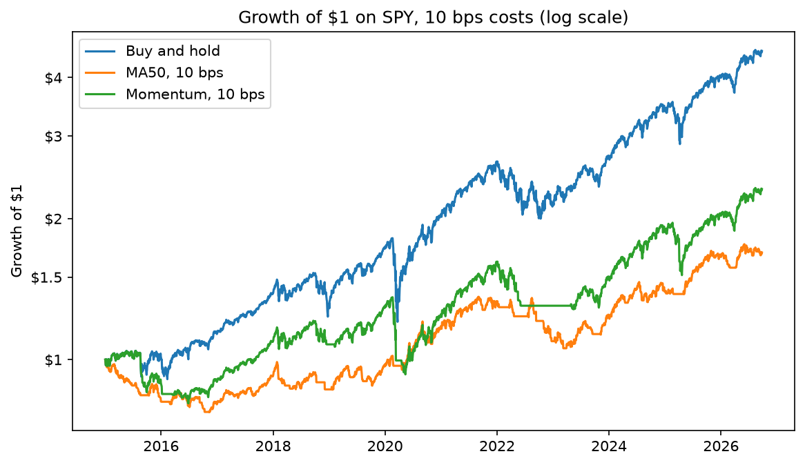
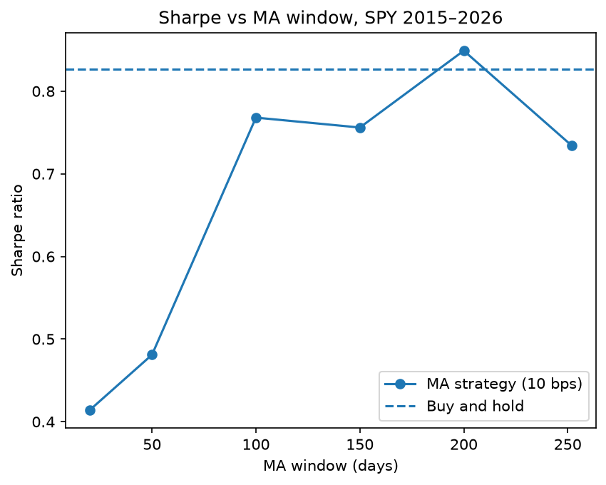

# Backtester
## Summary

I built a vectorized backtesting engine from scratch in Python/pandas, without backtesting libraries such as backtrader, and used it to test whether two trend-following strategies outperform buy-and-hold on SPY from 2014 to 2026: a moving-average trend filter (price vs its N-day average) and 12-month time-series momentum. Strategies were evaluated at 0, 10 and 30 bps transaction costs. After costs, buy-and-hold remained better on a risk-adjusted basis; long-window trend filters reduced the maximum drawdown from about 34% to about 20%, but at the cost of 4–5 percentage points of annual return.

## Why I built this

This is the second project in a self-directed series to build hands-on quantitative research skills. It builds on the database from the first project, a financial data pipeline that ingests and validates daily equity and crypto prices.
The goal was to learn how to test a trading idea without fooling myself: making the execution timing explicit to rule out look-ahead bias, including transaction costs from the start, and checking whether results survive across parameter choices and on out-of-sample data rather than reporting the best-looking backtest.

## Design

The project is split into four small modules, each with one job:

- **`data.py`**: `load_prices()` reads adjusted closing prices for one
  ticker from the SQLite database built in Project 1, using a
  parameterized SQL query. It raises an error if the ticker has no data,
  so problems surface immediately rather than later in the pipeline.
- **`signals.py`**: each strategy is a function that turns a price series
  into a 0/1 signal (1 = invested, 0 = cash), using only prices up to and
  including that day's close. Two are implemented: `ma_signal()` (price
  vs its N-day moving average) and `momentum_signal()` (price vs its level
  N days ago).
- **`engine.py`**: `run_backtest()` takes prices and any signal, checks
  that their dates match, and computes daily returns, the position (the
  signal shifted by one day), strategy returns, turnover (the absolute
  change in position), and net returns after transaction costs
  (turnover × cost in basis points).
- **`metrics.py`**: CAGR, annualized volatility, Sharpe ratio and maximum
  drawdown, plus `summary()`, which returns all four for a return series.

The engine receives the signal as an argument and knows nothing about the
strategy that produced it. The one-day shift therefore lives in a single
place, and every strategy automatically gets the same, correct timing.
New strategies only require a new signal function.

## Timing convention

The signal for day t is computed from prices up to and including the
close of day t. Because that closing price is only known at the end of
the day, a decision based on it cannot earn day t's price move. The
engine therefore shifts the signal by one day: the position held during
day t+1 is the signal from day t.

    position[t+1] = signal[t]
    strategy_return[t+1] = position[t+1] × market_return[t+1]

This assumes the position is changed at the close of day t, at that
day's closing price. In practice a trader would compute the signal
shortly before the close and trade at or near it, which is a reasonable
approximation for slow daily signals like these.

Transaction costs are charged on the day the position changes, in
proportion to turnover. Before the first signal, the strategy is
assumed to be in cash.

Example from the data: on 2014-04-10, SPY fell 2.1% and closed below
its 50-day average, so the signal switched to cash. The position that
day was still invested (it came from the previous day's signal), so the
strategy took the full loss. Without the shift, the backtest would have
avoided a loss it could not have avoided in reality.

## Assumptions

- **Long-only, no leverage.** Positions are either 1 (fully invested in
  SPY) or 0 (cash). No short selling or borrowing.
- **Starts in cash.** Before the first valid signal, the position is 0.
  Moving-average and momentum signals need a warm-up period of price
  history, during which the strategy holds cash.
- **Trades at the close.** Positions change at the closing price of the
  day the signal is computed (see Timing convention).
- **Transaction costs in basis points per unit of turnover.** A full
  entry or exit (turnover = 1) costs the stated number of bps; results
  are shown at 0, 10 and 30 bps. Costs cover fees and slippage together;
  no separate market-impact model.
- **Cash earns nothing, and the risk-free rate is zero.** Sharpe ratios
  are computed on raw returns. Since cash interest was positive for part
  of the period, this slightly understates the strategies' returns while
  in cash and overstates all Sharpe ratios.
- **Adjusted prices.** Returns use dividend- and split-adjusted closing
  prices, so buy-and-hold includes reinvested dividends.
- **252 trading days per year** for annualizing returns, volatility and
  Sharpe.
- **Common start date for comparisons.** When comparing strategies with
  different warm-up periods, all are measured from the same date (after
  the longest warm-up), so no strategy is penalized for time it could
  not trade.

## Results

All strategies are tested on SPY and measured over the same period,
from January 2015 to September 2026, after the longest warm-up period
(252 trading days). Transaction costs are shown at 0, 10 and 30 bps per
unit of turnover.

| Strategy         |  CAGR | Volatility | Sharpe | Max drawdown |
|:-----------------|------:|-----------:|-------:|-------------:|
| Buy and hold     | 13.8% |      17.5% |   0.83 |       −33.7% |
| MA50, 0 bps      |  6.5% |      10.5% |   0.66 |       −20.3% |
| MA50, 10 bps     |  4.6% |      10.5% |   0.48 |       −22.7% |
| MA50, 30 bps     |  0.8% |      10.5% |   0.13 |       −32.3% |
| Momentum, 0 bps  |  7.9% |      14.0% |   0.62 |       −31.2% |
| Momentum, 10 bps |  7.4% |      14.0% |   0.58 |       −31.6% |
| Momentum, 30 bps |  6.4% |      14.0% |   0.51 |       −32.4% |

Buy-and-hold had the highest Sharpe ratio (0.83) of all variants tested.
Costs matter most for the faster strategy: MA50 trades over 200 times in
the period, and its Sharpe falls from 0.66 at 0 bps to 0.13 at 30 bps.
At 30 bps it also loses its main advantage, as its maximum drawdown
(−32.3%) becomes almost as deep as buy-and-hold's. Momentum trades only
55 times, so costs affect it much less (Sharpe 0.62 → 0.51), and it
beats MA50 at 10 and 30 bps. MA50's one clear benefit, before high
costs, was a shallower drawdown: about −20% against −34%. Momentum's
drawdowns stayed close to buy-and-hold's.



The equity curves show where MA50 fell behind: in the choppy 2015–2016
market, it repeatedly exited after dips and re-entered after rallies.
During the 2020 crash, MA50 was out of the market for most of the fall,
while 12-month momentum stayed invested and fell almost as much as
buy-and-hold, because its one-year return remained positive for much of
the decline. After 2017, the curves rise at a broadly similar rate on
the log scale, so the early gap was never recovered.

## Robustness

### Sensitivity to the moving-average window

The MA strategy was re-run with windows from 20 to 252 days, at 10 bps
costs, over the same period as above.

| MA window (days) |  CAGR | Volatility | Sharpe | Max drawdown |
|-----------------:|------:|-----------:|-------:|-------------:|
|               20 |  3.8% |      10.3% |   0.41 |       −25.9% |
|               50 |  4.6% |      10.5% |   0.48 |       −22.7% |
|              100 |  8.3% |      11.2% |   0.77 |       −19.6% |
|              150 |  8.5% |      11.7% |   0.76 |       −22.5% |
|              200 |  9.8% |      11.8% |   0.85 |       −21.6% |
|              252 |  8.6% |      12.2% |   0.73 |       −24.5% |
|     Buy and hold | 13.8% |      17.5% |   0.83 |       −33.7% |



Performance improves clearly from short to long windows, then
plateaus between 100 and 252 days. Short windows trade more often and
react to day-to-day noise, so they pay more in costs and are whipsawed
more in choppy markets. Only the 200-day window edges past buy-and-hold
on Sharpe (0.85 vs 0.83), but this should not be read as an edge:

- **Selection bias.** It is the best of six windows tried on the same
  data, so its result is likely inflated.
- **Statistical noise.** Over about 11.7 years, the standard error of
  an annualized Sharpe estimate is roughly
  √((1 + SR²/2) / T) ≈ 0.34, far larger than the 0.02 difference.

The robust finding is the broad pattern (long windows beat short ones),
not the choice of any single window.

### In-sample / out-of-sample test

To test whether choosing the "best" window would have worked in
practice, the period was split: windows were ranked on 2015–2020
(in-sample) and then evaluated on 2021–2026 (out-of-sample), which was
not used in the choice.

| MA window (days) | In-sample Sharpe (2015–2020) | Out-of-sample Sharpe (2021–2026) |
|-----------------:|-----------------------------:|---------------------------------:|
|               20 |                         0.49 |                             0.34 |
|               50 |                         0.33 |                             0.63 |
|              100 |                         0.53 |                             1.01 |
|              150 |                         0.42 |                             1.12 |
|              200 |                         0.70 |                             1.01 |
|              252 |                         0.63 |                             0.85 |
|     Buy and hold |                         0.74 |                             0.92 |

- **In-sample, no window beat buy-and-hold.** The best, 200 days
  (0.70), was below buy-and-hold (0.74). Using only the data available
  at the start of 2021, the honest conclusion would have been not to
  use the strategy.
- **The in-sample winner was not the out-of-sample winner.** 150 days
  ranked fifth of six in-sample and first out-of-sample, which confirms
  that the ranking among long windows is mostly noise.
- **Out-of-sample, the long windows slightly beat buy-and-hold.** This
  mostly reflects the period: the 2022 bear market was a sustained
  decline, which suits trend filters. The gaps (0.08–0.19) are well
  within the noise, since with about 5.7 years of data the standard
  error is roughly 0.50.
- **The broad pattern held in both periods:** the 20-day window was
  poor in-sample and the worst out-of-sample.

### Sensitivity to costs

See the results table above: MA50's Sharpe falls from 0.66 to 0.13
between 0 and 30 bps, while momentum's falls only from 0.62 to 0.51,
because it trades about a quarter as often.

## Conclusions

- **Neither trend-following strategy beat buy-and-hold on a**
  **risk-adjusted basis.** Over 2015–2026, simply holding SPY had the
  highest or statistically indistinguishable Sharpe ratio in every test.
- **The trend filters' real effect was on risk, not return.** Long-window
  moving averages consistently reduced volatility and cut the maximum
  drawdown from about −34% to about −20%, at the cost of 4–5 percentage
  points of annual return. Whether that trade-off is worthwhile depends
  on the investor, not on the backtest.
- **Turnover decided how much of the signal survived costs.** The
  fast MA50 rule lost most of its value at realistic-to-high costs,
  while 12-month momentum, trading about a quarter as often, was much
  less affected. A signal cannot be judged without its turnover.
- **Fast and slow signals fail differently.** Fast filters protect
  quickly in crashes but are whipsawed in choppy markets; slow signals
  trade cheaply but react late, as momentum did in the 2020 crash.
- **Results depend heavily on the market regime.** The filters lagged
  in the choppy, rising market of 2015–2020 and slightly led in
  2021–2026, which included the sustained 2022 bear market.
- **Only the broad pattern was robust.** Long windows beat short ones
  in both periods, but the ranking among long windows changed out of
  sample, and the differences were within statistical noise.

### What I learned

Building the engine from scratch made the common failure points
concrete: a single missing shift would have produced impossible
results, costs that look negligible per trade compound into a large
drag, and choosing the best of several parameters on the same data
inflates results. The most useful habits from this project were
checking every result against a known answer, changing one input at a
time, and treating the out-of-sample period as the only honest test.

## Limitations

- **One asset and one period.** All tests use SPY from 2015 to 2026, a
  strong, mostly rising market with short, sharp crashes. Trend filters
  may behave very differently on other assets (bonds, commodities,
  crypto) or in long sideways or falling markets.
- **Limited statistical power.** About 11.7 years of daily data gives a
  Sharpe standard error of roughly ±0.34 (±0.50 for the 5.7-year
  out-of-sample period), so most differences between strategies cannot
  be distinguished from noise.
- **A single in-sample/out-of-sample split.** One split gives one
  out-of-sample result, which depends on which regime falls on which
  side. Walk-forward testing (repeated splits through time) would be
  more reliable.
- **Simple cost model.** Costs are a flat number of basis points per
  unit of turnover. There is no separate bid-ask, slippage or market
  impact model, and no taxes.
- **Execution at the close.** The backtest assumes trades at the closing
  price of the signal day. The sensitivity of results to a one-day
  execution delay was not tested.
- **Cash earns nothing.** Days out of the market earn 0% rather than a
  money-market rate, which slightly understates the strategies' returns,
  particularly in 2023–2026.
- **Simple position sizing.** Positions are all-or-nothing (0 or 1), with
  no volatility targeting, leverage or short selling.
- **Momentum parameters were not varied.** Only the 12-month lookback
  was tested; the window grid covers the moving-average strategy only.

## How to run

### Requirements

- Python 3.12
- The SQLite price database from
  [Project 1: financial data pipeline](https://github.com/Alenchikk1/financial-data-pipeline).
  The database is not included in this repo.

### Setup

```bash
git clone https://github.com/Alenchikk1/backtester.git
cd backtester
python3 -m venv venv
source venv/bin/activate
pip install -r requirements.txt
```

By default, the notebooks expect the two repos side by side in the same
parent folder, with the database at
`../financial-data-pipeline/data/market.db`. If yours is elsewhere,
change `DB_PATH` at the top of the notebook.

### Run

Open `notebooks/02_first_backtest.ipynb` and run all cells. It loads
the data, runs every backtest, and saves the figures to `figures/`.

### Project structure

```
backtester/
├── src/
│   ├── data.py        # load prices from the SQLite database
│   ├── signals.py     # strategy signals: MA filter, momentum
│   ├── engine.py      # backtest engine: timing, returns, costs
│   └── metrics.py     # CAGR, volatility, Sharpe, drawdown, summary
├── notebooks/
│   ├── 01_timing_check.ipynb     # timing convention verified by hand
│   └── 02_first_backtest.ipynb   # all backtests, tables and figures
├── figures/           # charts used in this README
├── requirements.txt
└── README.md
```